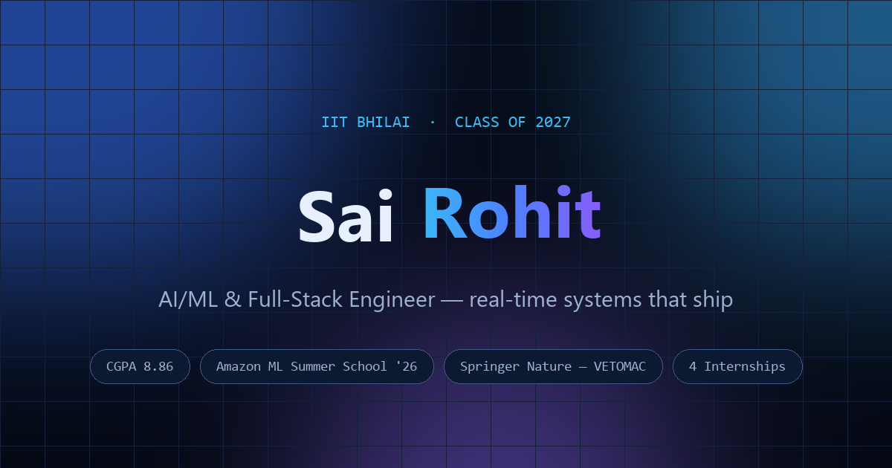

# Sai Rohit — Portfolio

Personal portfolio of **Swarna Venkata Sai Rohit** — AI/ML & Full-Stack Engineer, B.Tech EE @ IIT Bhilai ('27).

Live: **https://rohit02k5.github.io/Portfolio-Website/**



## Stack

- **Vite 6 + React 18 + TypeScript** — statically exported single-page site
- **Tailwind CSS v4** — CSS-first design tokens (`src/index.css`)
- **lucide-react** — icons
- Self-hosted variable fonts (Space Grotesk / Inter / JetBrains Mono via Fontsource)
- Zero heavy deps: no WebGL, no particle libraries — all animation is transform/opacity via CSS + IntersectionObserver

## Performance

- Initial JS ≈ **64 KB gzipped** (React + app); case-study modal is code-split
- LCP < 2s, CLS < 0.05, no layout-shifting reveals (translate-only)
- `prefers-reduced-motion` respected everywhere; cursor glow / tilt only on fine pointers

See `docs/audit-before.md` and `docs/audit-after.md` for Lighthouse numbers.

## Develop

```bash
npm install
npm run dev        # http://localhost:5173/Portfolio-Website/
npm run build      # type-check + production build → dist/
npm run preview    # serve the production build locally
npm run lint       # eslint
npm run format     # prettier
```

## Editing content

**Everything on the page renders from `src/data/content.ts`.**
Update experience, projects (including the case-study modal content), skills,
awards, education, and social links there — no component changes needed.

- Replace the résumé PDF at `public/Swarna-Venkata-Sai-Rohit-Resume.pdf` (update `site.resumeFile` if the name changes).
- Replace the portrait at `public/portrait.webp` / `portrait.jpg`.
- Design tokens (colors, fonts) live at the top of `src/index.css`.

## Deployment

GitHub Actions (`.github/workflows/deploy.yml`) builds `dist/` and deploys to
GitHub Pages on every push to `main`. Pages source must be set to
**Settings → Pages → Source → GitHub Actions**.

Base path is `/Portfolio-Website/` (set in `vite.config.ts`); change `base` if the
repo is renamed. `public/404.html` handles deep links/refresh on Pages.
